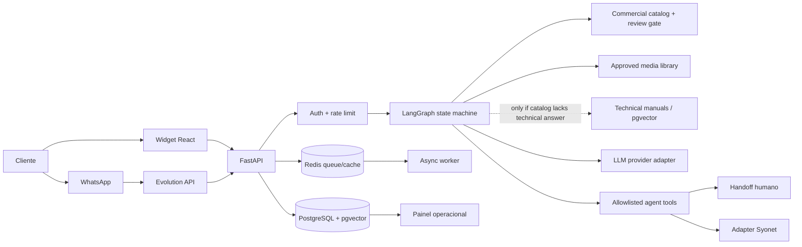

# Arquitetura MVP

## Objetivo e limites

Atender clientes interessados em comprar veículos Leapmotor, apresentar modelos e mídias aprovadas, explicar tecnologias, comparar versões e qualificar oportunidades. A prioridade é o catálogo comercial estruturado e versionado; manuais são recuperação técnica complementar e não FAQ primário. Preço/oferta só é exibido com registro aprovado e vigente. Estoque e disponibilidade são sempre consultados por fonte local, nunca inferidos da página nacional. Handoff humano fica disponível em todos os fluxos.

## Componentes

## Estados de conversa

`received → authenticated → loaded → classified → retrieved → responded | abstained | handoff_pending → handed_off`. Uma oportunidade pode seguir `lead_detected → awaiting_consent → authorized → crm_pending → crm_sent | crm_failed`. Transições são validadas no domínio; chamadas externas só acontecem por ferramentas explícitas allowlisted, com consentimento registrado e chave de idempotência.

## ADRs

### ADR-001: API modular com fronteiras de adapter

FastAPI recebe e valida entradas; domínio não depende de Evolution, Syonet ou fornecedor LLM. Adapters implementam portas tipadas e seus contratos ficam versionados. Isso permite executar o fluxo sem segredos usando doubles locais.

### ADR-002: LangGraph com estado tipado e abstenção

Fluxo explícito e persistível por thread. Retrievers retornam IDs e versões; resposta factual requer evidência. Baixa confiança/ausência de fontes gera abstention e oferta de humano. Texto do cliente e documentos recuperados são dados não confiáveis, nunca instruções de sistema.

### ADR-003: PostgreSQL como fonte de verdade

Mensagens, eventos, decisões, consentimentos, oportunidades e jobs são persistidos no Postgres. pgvector armazena embeddings associados a documento/versão/chunk. Redis é auxiliar para fila/cache; processamento é idempotente e recuperável a partir do banco.

### ADR-004: side effects bloqueados por padrão

Integrações de envio começam desativadas. Gravação no CRM exige consentimento auditável e schema configurado pelo cliente. Evolution webhook precisa de autenticação, validação de assinatura/token, dedupe por ID do provedor e proteção contra replay. Sem configuração, retornamos erro explícito e nenhum side effect ocorre.

### ADR-005: catálogo comercial aprovado é fonte de verdade de pré-vendas

Modelos, versões, especificações, itens de série e mídias são registros com fonte, data de captura, versão/ano-modelo e estado editorial. A ferramenta de consulta só serve itens aprovados; ofertas também precisam de validade ativa e aprovação. A ingestão cria drafts e nunca publica automaticamente. O site nacional não prova preço local nem estoque.

### ADR-006: mídia é referenciada e entregue fora do LLM

Seleção de imagem é filtro determinístico sobre modelo/versão/ano/cor/categoria e permissão. O LLM recebe metadados e referência aprovada se necessário; o backend/Evolution envia o asset por URL ou storage URI permitido. Direitos e proveniência precisam ser aprovados antes de distribuição. Sem storage/rights approval, asset não é retornado.

### ADR-007: ferramentas comerciais são tipadas e side effects isolados

Consulta de veículos, comparação e mídia é determinística. Qualificação é baseada em campos explicitamente coletados. Syonet requer dados mínimos, consentimento válido, chave idempotente e adapter configurado; o modelo não decide autorização. Handoff é ferramenta separada.

### ADR-008: política comercial financeira é externa ao LLM

O assistente só faz pré-vendas informativas. Não informa preço, parcelas, taxas, descontos, promoções, condições de pagamento ou avaliação de usados e não negocia, reserva nem fecha venda. `CommercialPolicyEngine` classifica solicitações e valida respostas sem depender do modelo. Oferta pode permanecer no domínio/catalog interno, mas não há ferramenta financeira na superfície do agente e a projeção para contexto do modelo usa allowlist de campos não financeiros. Pedido proibido recebe resposta segura e opção de consultor.

### ADR-009: readiness verifica Postgres e Redis

`/health/ready` responde sucesso somente após `SELECT 1` no banco e `PING` no Redis; falha em dependência necessária retorna 503 sem revelar credenciais ou detalhes internos. `/health/live` permanece independente dessas dependências.

## Decisões pendentes para descoberta

- Identificador estável do cliente por canal, política de retenção, base legal, controlador/operador e processo de direitos LGPD.
- Catálogo oficial por versão/ano-modelo: ficha completa de C10/B10, fonte, owner de aprovação e política de expiração.
- Feed local por concessionária para preço/estoque/ofertas; a ausência desse feed deve provocar abstenção.
- Direitos de uso, formatos e storage aprovado para imagens do site/campanhas.
- Modelo/fornecedor permitido, região de processamento, limites de custo e retenção de dados pelo fornecedor.
- Contratos Evolution (versão, webhook, assinatura, rate limits) e Syonet (endpoint, autenticação, campos obrigatórios, idempotência, sandbox).
- Critérios de lead qualificado, horários/fila de handoff e métricas de negócio.
- Identidade do painel, RBAC, SSO e auditoria.
