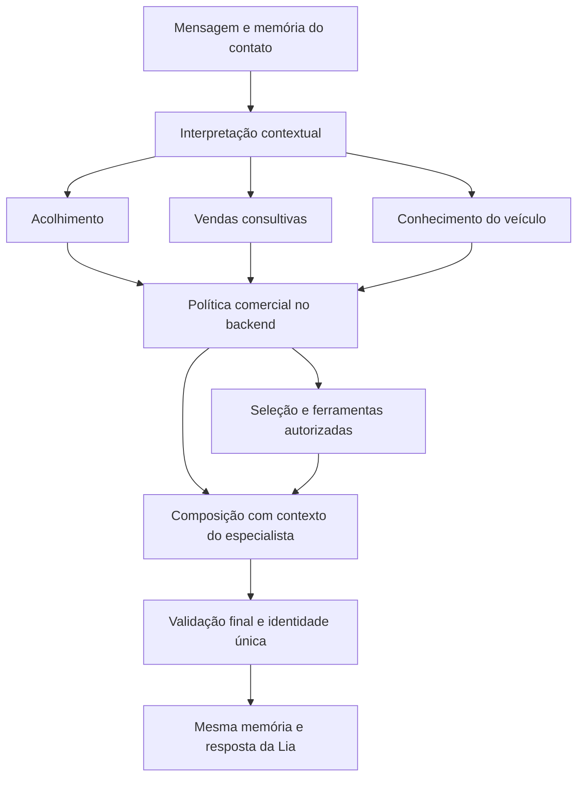

# Lia: especialistas internos com uma única conversa

## Proposta e limite desta entrega

O cliente conversa com a Lia. Ela se identifica como assistente virtual uma vez, acolhe e reconhece a intenção pelo texto e pelo contexto. Não pede que a pessoa escolha vendas/FAQ, não anuncia transferência entre agentes e não exige repetir nome ou interesse. Perguntas de modelo e versão continuam possíveis quando necessárias para responder ou selecionar fotos com segurança.

A estrutura foi implementada na branch `feat/lia-internal-specialists`, a partir de `06f915f`. Ela permanece **desativada por padrão**. O WhatsApp não foi reiniciado nem atualizado nesta execução. Validação real com Groq continua pendente de autorização, conforme o limite solicitado pelo responsável.

## Diagnóstico que motivou a divisão

No fluxo anterior, consult misturava observação, interpretação e decisões comerciais. Mensagens desconhecidas tinham pouca distinção entre dúvida, confusão e interesse. Uma apresentação aberta recuperava potência/porta-malas; o compositor acrescentava esses fatos como uma ficha técnica. Respostas como “Ah?” podiam ser interpretadas como indecisão, sem evidência. Acrescentar documentos não corrigia esse problema de decisão.

## Arquitetura implementada

Existe um único SalesAgent, um adaptador configurável de LLM e um LangGraph compilado por instância. A aplicação não criou outro projeto, sessão, serviço ou grafo de especialistas. O modo antigo é mantido temporariamente pelo flag de ativação para comparação e reversão.



O diagrama resume os caminhos: respostas determinísticas podem sair do guard para output; erros de ferramentas também passam por output. Nenhum especialista possui caminho próprio que evite a validação final ou o transporte existente.

### Responsabilidades

| Componente | Trabalho | Autoridade |
|---|---|---|
| Roteador | Interpreta ato conversacional com histórico, última pergunta e veículo | Sem ferramentas, sem consentimento ou mutações externas |
| ReceptionSpecialist | Acolhe, reconhece nome/memória, esclarece mensagens ambíguas e repara sua última resposta | Somente listagem de catálogo; não escolhe detalhes técnicos por conta de intenção desconhecida |
| SalesSpecialist | Explora rotina, apresenta fatos novos, qualifica progressivamente e prepara visita | Listagem/detalhes/mídias aprovadas; dados locais por mecanismos já existentes |
| KnowledgeSpecialist | Responde perguntas e localiza fotos aprovadas, sem substituir a dúvida por questionário comercial | As mesmas três ferramentas somente de leitura |

As instruções dos especialistas são distintas e aplicadas na composição. Seus executores e permissões de ferramentas são definidos no backend. Não são três modelos conversando entre si nem agentes com loops abertos. Todos usam o provedor configurado, incluindo Groq, e o mesmo estado.

### Interpretação e chamadas

`RouteHint` aceita atos e tópicos enumerados, rejeita campos extras e não aceita IDs de ferramentas, endpoints, consentimento ou destinatários. Saudações, restrições e outros casos inequívocos usam atalhos determinísticos. Mensagens abertas usam interpretação pelo LLM com contexto compacto. `other` volta ao acolhimento, sem consulta técnica automática.

O orçamento existente continua compartilhado: no máximo duas chamadas LLM por turno, incluindo roteador, seleção e composição. A seleção usa ferramentas determinísticas quando a interpretação já consumiu uma chamada. Uma falha de classificação retorna uma pergunta simples, sem gastar outro timeout tentando redigir. As permissões são verificadas antes do dispatch real da ferramenta.

A apresentação comercial considera uso, necessidades e IDs já apresentados. Por exemplo, viagens priorizam autonomia/recarga; espaço prioriza porta-malas/bancos quando documentados. Fatos já apresentados são excluídos. A composição continua vinculada às evidências e revalida fonte/aprovação após a chamada. Uma dúvida sobre recarga doméstica prioriza evidência AC, sem substituir por um tempo DC.

## Memória e proteção

Nome e telefone continuam vinculados pelo identificador protegido do contato e pelo mesmo PilotStore. Trocar especialista não cria outro atendimento nem outro cadastro. `active_specialist` e um resumo de roteamento são campos JSON aditivos. Trechos usados para apoiar extração não são acrescentados à telemetria de roteamento.

CommercialPolicyEngine, barreira HTTP, autenticação, consentimento, catálogo/mídias e restrições de transporte foram preservados. Pedido de compra não autoriza vendedor; pedido explícito e consentimento continuam necessários. Não há ferramenta financeira, escrita CRM, reserva, negociação ou agendamento nos especialistas. Uma mensagem de áudio transcrita usa o mesmo grafo e devolve somente texto.

As métricas internas registram especialista, ato, origem da interpretação e falha sanitizada. Falha de provedor, timeout e interpretação inválida são distinguidos. Esses campos não entram no AssistantResponse do cliente.

## Configuração e avaliação

```dotenv
LIA_ORCHESTRATION_ENABLED=false
```

O flag é configuração de servidor, não argumento aceito na mensagem do cliente. Para testes isolados, `build_agent(..., orchestration_enabled=True)` ativa os nós no mesmo grafo. A ativação no piloto deve ocorrer somente depois de revisar as conversas reais controladas; não basta tornar o flag true porque os testes determinísticos passaram.

Comando sem API paga:

```bash
python3 -m pytest -q tests/unit/test_internal_specialists.py
```

A suíte inclui 20 diálogos completos em `tests/fixtures/conversations/lia-specialists.json`, além de testes específicos de capacidade, orçamento, isolamento, memória após reinício, áudio normalizado, falta de fonte, segurança, consentimento e reação confusa. A avaliação não usa apenas snapshots: verifica estado, ferramentas invocadas, permissões, fontes, orçamento e separação por contato.

As transcrições comparativas em [lia-specialists-before-after.json](evaluations/lia-specialists-before-after.json) foram executadas com o mesmo simulador nas versões base e candidata. Elas demonstram comportamento do código/contrato. Não são avaliações reais de naturalidade, compreensão pelo Groq ou conversão comercial.

Revisão humana ainda necessária: relevância, continuidade, naturalidade, repetição, pertinência da pergunta, grounding e convite de visita. Não foram atribuídas notas subjetivas nem declarada melhoria de vendas.

## Limitações conhecidas

- O classificador pode errar; evidência textual de extração não é prova geral de interpretação semântica.
- O mecanismo comum consult e a renderização factual conservadora permanecem. Esta é uma divisão incremental, não uma reescrita completa da conversa.
- Permanecem heurísticas de nomes, intenções e validação de prosa, com cobertura parcial de paráfrases. Fallbacks seguros ainda existem.
- Catálogo limitado e sem dados da loja/agenda não pode responder toda dúvida ou confirmar visita.
- Esta entrega cobre pré-vendas e dúvidas de veículos; não cria operação completa de pós-venda.
- Múltiplos especialistas não garantem qualidade. É indispensável avaliar o comportamento real antes de substituir o piloto.
- Não houve inferência paga, envio real, deploy, merge ou push nesta execução.

Gates executados nesta entrega: 407 testes Pytest passaram (20 diálogos completos na suíte nova), Ruff passou, compilação Python passou e `git diff --check` passou. O aviso de depreciação upstream do LangChain permanece. Varredura dos valores reais de credenciais não encontrou segredos no diff/arquivos novos. Os caminhos CommercialPolicyEngine, barreira HTTP, dados de catálogo e mídias não foram modificados. Não houve revisão independente ou avaliação paga nesta execução.

### Abertura orientada ao motivo do contato

Na versão com especialistas habilitados, a identificação pública passa a ser
“Lia, assistente virtual da Leapmotor”, sem o título interno “de IA de pré-vendas”.
A saudação pergunta o motivo do contato antes do nome; perguntas específicas
continuam sendo atendidas diretamente. Nome voluntário permanece no perfil
persistente. A saída não acrescenta uma pergunta obrigatória sobre nome.

Regressões adicionais: cinco saudações, consulta de modelos e seleção numérica
sobre opções canônicas previamente apresentadas. A seleção numérica não cria
um menu obrigatório. O caminho legado com a flag desativada permanece intacto.

Estas mudanças não foram ativadas no WhatsApp. O endereço e horário da unidade
não foram cadastrados nem verificados nesta execução; não há evidência para
prometer que essas informações estão disponíveis. Avaliação com Groq e revisão
humana da naturalidade continuam pendentes de autorização para chamadas reais.
