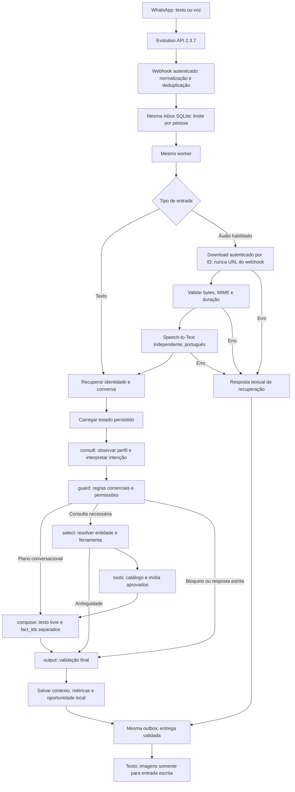

# Lia v3 — composição contextual e entrada de voz

Status: implementação em avaliação na branch `feat/lia-v3`, em checkout isolado. Referência: `1db98ff` (`feat/lia-conversation-quality`). Serviço ativo, `.env`, credenciais e aprovação das fotos não foram alterados. Sem deploy, merge ou push.

## Diagnóstico e preservação da refatoração anterior

A refatoração começou antes desta ampliação de escopo e foi mantida:

- `app/agent/service.py:consult`: LLM escolhia índice de variantes; reações sociais eram compostas sob vocabulário fechado. Rotina, distâncias e recarga podiam terminar em templates. Agora produz um plano de composição e encaminha à mesma etapa `compose`.
- `guard`: política e consentimento continuam fora do modelo. A saudação permite composição, com apresentação de identidade aplicada uma vez pelo backend.
- `select`: preserva veículo/motorização canônicos, esclarecimento e seleção determinística. Uma resposta curta de motorização mantém a pergunta técnica original.
- `tools`: mesmas três consultas permitidas, aprovação e isolamento. Para entrada de voz, respostas são exclusivamente textuais; ferramentas de mídia não enviam imagens nesse caminho.
- `compose`: antes renderizava frases prontas ou exigia apenas `fact_ids`. Agora aceita formulação conversacional e referências de fatos em campos separados.
- `output`: continua validando e restringindo handoff a pedido explícito. Não repete apresentação. Nome conhecido é recuperado do estado persistido.
- `app/agent/social.py`: removida a allowlist de vocabulário. Reconhecimento de reações foi ampliado e não interpreta “Achei muito bonito” como nome.
- `app/agent/composition.py`: contrato tipado, entidades, evidências, plano de perguntas e validação independente. Não é outro agente.

Evidência inicial: seis probes de regressão falharam antes da correção (texto natural rejeitado, recarga por template e respostas curtas/reações). Outro probe reproduziu handoff não solicitado no fallback HTTP de erro. A barreira continua fail-closed; somente seu fallback e a detecção de substituição por política foram ajustados para não oferecer humano automaticamente. `CommercialPolicyEngine` não foi alterado.

## Plano incremental executado

1. Registrar baseline sintético e reproduzir falhas.
2. Separar interpretação, plano, evidências, formulação e validação no grafo existente.
3. Acrescentar memória explícita, primeiro contato e categoria `other`.
4. Normalizar áudio na fila existente; validar e transcrever antes do mesmo agente.
5. Acrescentar regressões, métricas e transcrições; executar gates.
6. Manter ativação externa e avaliação humana como etapas posteriores.

## Fluxo implementado



Nós LangGraph permanecem `consult`, `guard`, `select`, `tools`, `compose`, `output`. Não há segundo grafo, novo agente, ferramenta de execução ou CRM.

## Liberdade conversacional e limites factuais

Contrato interno `ConversationDraft`: `text`, `fact_ids` e `question` opcional. Modelo não escolhe fontes, IDs de mídia, destino, consentimento ou ações externas. Perguntas têm chave vinculada ao plano; perguntas repetidas/respondidas podem ser suprimidas. Texto cotidiano não precisa pertencer a uma lista de palavras.

Afirmações técnicas são renderizadas a partir de fatos revisados e fontes atuais. O backend confere IDs e revalida aprovação/valor/fonte depois da chamada ao modelo, antes de renderizar. Não se libera paráfrase factual irrestrita. Prosa passa por política, verificações de entidades, identificadores/valores e padrões de afirmação; saída pública continua em `AssistantResponse` e na barreira/adapter do canal.

**Limite importante:** o filtro de prosa é heurístico e conservador. Não demonstra entailment semântico geral e pode rejeitar uma formulação legítima ou deixar passar uma alegação inédita não coberta pelos testes. O contrato de fatos estruturados reduz a superfície; não substitui avaliações adversariais e revisão humana. Esta branch não foi ativada no piloto.

## Primeiro atendimento e memória

- `Oi` e `Opa`: composição contextual, identidade como IA aplicada pelo backend uma vez. Nome é opcional e não impede fotos ou informação.
- Interesse direto no B10: uma clarificação de BEV/REEV quando necessária; não pede nome antes da seleção. C10 usa a variante aprovada identificável.
- Interior do C10: consulta e retorna mídia aprovada, sem substituí-la por qualificação.
- `Qual meu nome?`: responde do perfil persistido, sem catálogo nem inferência; se desconhecido, informa isso.
- `Em casa`: observa a pergunta pendente de recarga e atualiza o mesmo perfil.
- Intenções desconhecidas com veículo em contexto podem usar `InterpretedIntent` com histórico, última pergunta e perfil. `other` mantém diálogo seguro em vez de forçar consulta técnica. Hints semânticos não autorizam handoff; atualização de uso exige um trecho literal da mensagem.
- Primeiro atendimento genérico sem veículo ainda conserva alguns caminhos de esclarecimento/listagem do fluxo anterior. Interpretação não é universal; regex permanece como fast path, não como único caminho.

**Marca:** não existe resumo institucional aprovado na base atual. A Lia pode apresentar os modelos aprovados, mas não inventa origem, história ou vínculos empresariais. Aprovar conteúdo institucional continua pendente. O grounding permanece com três fatos técnicos; não foi ampliado artificialmente pelo modelo.

## Áudio: contrato verificado e limites

Versão real inspecionada: Evolution API **2.3.7**, incluindo `getBase64FromMediaMessage` no source map instalado. O método resolve a mensagem persistida por `message.key` quando o conteúdo não é enviado no request.

- Webhook `MESSAGES_UPSERT/messages.upsert`, `data.message.audioMessage`, metadados `mimetype`, `fileLength`, `seconds`, `ptt`.
- Persistimos somente ID do provedor e metadados limitados, sem `url`, `directPath`, `mediaKey` ou áudio bruto.
- Download por `POST /chat/getBase64FromMediaMessage/{instance}` com token da instância e `{message:{key:{id}},convertToMp4:false}`. Endpoint, instância e autenticação são configuração do servidor.
- A Evolution devolve base64; o backend limita a resposta e decodifica em memória. Isso é transporte exigido por esse endpoint, não envio de áudio/base64 ao LLM conversacional.
- Suporte inicial: **Ogg/Opus** (container, páginas, CRC, sequência, duração por granule) e **WAV PCM** (formato, frames, duração). AAC, MP4, MP3 e outros formatos são recusados de forma útil nesta versão. Não foi instalado FFmpeg.
- Limites padrão: **2 MB, 120 segundos, STT 30 segundos**, um worker. Há 40 eventos por contato/dia, compartilhados com texto. Não há orçamento global para todos os remetentes.
- Ogg não passa por decodificação Opus completa local; testes reais com arquivos de voz são obrigatórios antes da ativação. O provedor pode recusar arquivos que passaram na inspeção de container.
- STT Groq: upload binário multipart, `language=pt`, `verbose_json`, sem ferramentas e sem retry automático. Transcrição não vazia, tamanho limitado e detecção básica de ausência de fala.
- A transcrição entra como texto não confiável no mesmo `SalesAgent.turn`, mantendo remetente e conversa. Não há TTS ou envio de áudio. Pedido de fotos via voz recebe orientação textual para pedir imagens por escrito.
- Exclusão solicitada por voz exige confirmação escrita, evitando ação destrutiva sobre transcrição possivelmente incorreta.

Fontes: [contrato Evolution](https://docs.evoapicloud.com/api-reference/chat-controller/get-base64), código da imagem instalada; [STT Groq](https://console.groq.com/docs/speech-to-text). A página Evolution retornou erro de acesso nesta consulta; o contrato foi confirmado pelo código instalado, não por suposição.

## Configuração — não aplicada em produção

| Variável | Padrão / finalidade |
| --- | --- |
| `EVOLUTION_AUDIO_ENABLED` | `false`; ativação explícita de voz |
| `AUDIO_MAX_BYTES` | `2000000` |
| `AUDIO_MAX_SECONDS` | `120` |
| `STT_PROVIDER` | `disabled`; implementação inicial `groq` |
| `STT_MODEL` | `whisper-large-v3-turbo` |
| `STT_API_KEY` | Segredo próprio do STT; não é automaticamente o token do LLM |
| `STT_TIMEOUT_SECONDS` | `30` |
| `STT_USD_PER_AUDIO_HOUR` | Opcional; tarifa mantida pelo operador |
| `LLM_INPUT_USD_PER_MILLION` | Opcional; tarifa de entrada do modelo efetivo |
| `LLM_OUTPUT_USD_PER_MILLION` | Opcional; tarifa de saída do modelo efetivo |

Áudio habilitado sem STT válido impede startup. Preencher segredos por mecanismo privado e conferir modelo/permissões antes do piloto. Não foi criado `.env` com credenciais no checkout de avaliação.

A documentação Groq consultada informa US$ 0,04/h para Whisper Turbo e cobrança mínima de 10 segundos por request. Valores podem mudar; estimativa usa somente tarifa configurada. Sem tarifa ou tokens, custo fica desconhecido, não zero. Timeout pode ter cobrança não confirmada. Tokens dos mocks não representam consumo real.

## Persistência e privacidade

Migração SQLite aditiva: `input_type`, `audio_ref`, `metrics`; teste preserva linhas do esquema anterior. Referência de áudio é limpa após normalização/resposta pronta ou finalização. Não há arquivo de áudio em disco no aplicativo; isso não significa retenção zero na Evolution/WhatsApp/Groq.

Histórico compacto de transcrição pode permanecer no estado da conversa, como mensagens escritas. Exclusão local limpa perfil, conversa, oportunidades e pendências. Conteúdos de inbox/outbox e perfis antigos são limpos após 30 dias, no startup e em manutenção horária do worker. Tombstones opacos permanecem contra replay. Exclusão é lógica; não garante remoção forense de WAL/backups ou dados nos provedores.

STT não é repetido para evento duplicado. Interrupção de processamento vai para revisão na recuperação; envios incertos não são reenviados automaticamente. Uma falha pode resultar em cobrança sem confirmação e requer análise, não replay cego.

## Observabilidade

Por turno: tipo de entrada, interpretação/falha de interpretação, ação, ferramentas, chamadas/tokens, latência acumulada LLM, perguntas consecutivas, repetição, origem da composição e motivo de fallback. Métricas de áudio distinguem latência total de normalização e tempo STT, duração, falha e custo estimado quando configurado. Logs e métricas operacionais não contêm áudio, transcrição, nome, telefone, prompt completo ou resposta bruta do provedor.

Motivos distintos: `provider_timeout`, `provider_failure`, `invalid_draft_schema`, `commercial_policy`, `unsupported_fact_id`, `repeated_response`, `interpretation_failure`, `stt_timeout`, `no_speech`, `media_unavailable`, entre outros. Ausência de conhecimento é intenção `missing_evidence`, não falha técnica do provedor. Legendas, consentimento, exclusão e certas clarificações continuam determinísticos e não são contados como prosa redigida pelo modelo.

## Validação executada e pendências

- **305 testes passaram**, incluindo conversas completas, memória após reinício, input de voz/texto, parser, download autenticado, limites, integridade/container, falha STT, silêncio, duplicidade, autorização, fila/outbox, migração, retenção e política comercial.
- Ruff, compilação Python e `git diff --check` passaram. Permanece um aviso upstream LangChain de depreciação.
- Matriz: 28 diálogos, 111 turnos; inputs de voz na matriz usam transcrições sintéticas. O transporte de voz é avaliado separadamente com bytes gerados e STT/entrega simulados.
- Baseline foi executado do arquivo Git de `1db98ff` em diretório temporário, sem tocar o serviço. O mock conhece o protocolo anterior e o novo; não é comparação de modelos reais.
- [Antes](evaluations/lia-v3-before.json), [depois](evaluations/lia-v3-after.json), [áudio/texto integrado](evaluations/lia-v3-audio-evidence.json). Artefatos `lia-quality-*` preservam a etapa intermediária de 22 diálogos anterior à v3.
- **Não executados:** inferência real conversacional, transcrição real, entrada de voz de telefone, entrega WhatsApp desta versão, revisão humana de naturalidade e avaliação prolongada de carga. Instalação/contrato real não comprova essas etapas.

Executar novamente:

```bash
python3 -m pytest -q
python3 -m ruff check app tests scripts
python3 -m compileall -q app tests scripts
git diff --check
python3 -m scripts.evaluate_lia_quality --output /tmp/lia-v3-evaluation.json
```

Não ativar no serviço sem revisar transcrições, testar arquivos Ogg reais, aprovar orçamento de chamadas e validar provedor/modelo no ambiente desejado. Não há mudança de modelo, CRM ou deploy neste checkpoint.

## Comparação estrutural observada — modelo simulado

| Indicador | Baseline | V3 |
| --- | --- | --- |
| Respostas exatamente repetidas | 8 | 1 |
| Turnos sociais com consulta técnica | 9 | 0 |
| Respostas com múltiplas perguntas | 0 | 0 |
| Violações detectadas pela política | 0 | 0 |

Composição redigida pelo mock e aceita: 50/111 turnos (45.0%). Proporção anterior indisponível por falta de instrumentação; não foi tratada como zero. Motivos de fallback: `{"repeated_response": 5}`. A métrica social usa referência fixa independente dos classificadores das versões.

Esses números medem o harness e os caminhos exercitados, não a qualidade de um modelo real. O mock pode repetir frases e foi adaptado ao novo schema; isso limita conclusões sobre naturalidade e linguagem. Não houve comparação paga de provedores.

### Trechos reais do replay sintético

**Cliente:** Achei muito bonito

**Antes:** Prazer, Achei muito bonito. Podemos continuar explorando o carro por aqui.

**Depois:** Pelo que você contou, o visual chamou sua atenção. Podemos olhar a escolha a partir da sua rotina.

**Cliente:** Em casa

**Antes:** Anotei essa possibilidade de recarga. Isso ajuda a entender sua rotina; a compatibilidade e os detalhes técnicos do veículo ainda precisam ser verificados nas fontes aprovadas.

**Depois:** Você mencionou recarga em casa. Vou considerar isso ao longo da conversa.

**Cliente:** Qual meu nome?

**Antes:** Podemos explorar B10 BEV, B10 REEV, C10 BEV. Qual você quer conhecer primeiro?

**Depois:** Você pediu para eu te chamar de Pessoa Sintetica.

### Rubrica de qualidade humana — pendente

| Dimensão | Evidência automática disponível | Revisão humana necessária |
| --- | --- | --- |
| Relevância | intenção, ferramenta, seleção canônica e fontes | Responde ao pedido real? |
| Continuidade | memória, última pergunta e recuperação após reinício | Aproveita o que foi contado? |
| Naturalidade | schema livre, fallback e ausência de vocabulário fechado | Soa natural em WhatsApp brasileiro? |
| Escuta | reação/rotina/objeção separadas; interpretação com contexto | Reconhece tom e nuances corretamente? |
| Utilidade | evidência, fotos e respostas diretas de memória | Entrega valor antes de perguntar? |
| Repetição | igualdade textual e perguntas consecutivas | Repete ideias ou abertura com outras palavras? |
| Fundamentação | IDs/fonte/aprovação; testes de ataques | Há alegação implícita sem respaldo? |

Avaliar cada dimensão de 1 a 5 com justificativa e exemplos, no mesmo conjunto de diálogos. Nenhuma nota humana foi preenchida artificialmente. Antes do piloto real: definir orçamento, transcrever vozes autorizadas, revisar falhas e comparar candidatos de modelo sem alterar a política.
