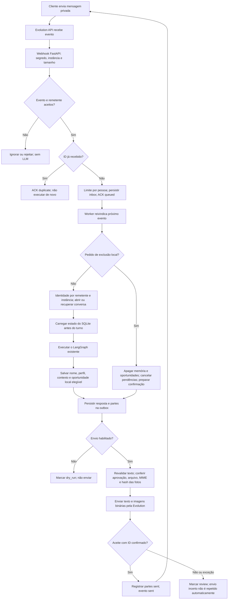
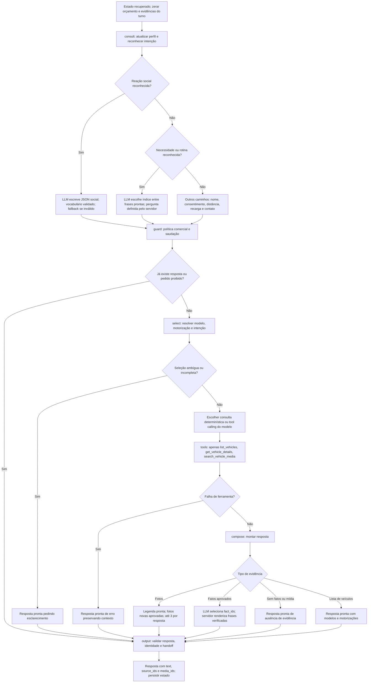
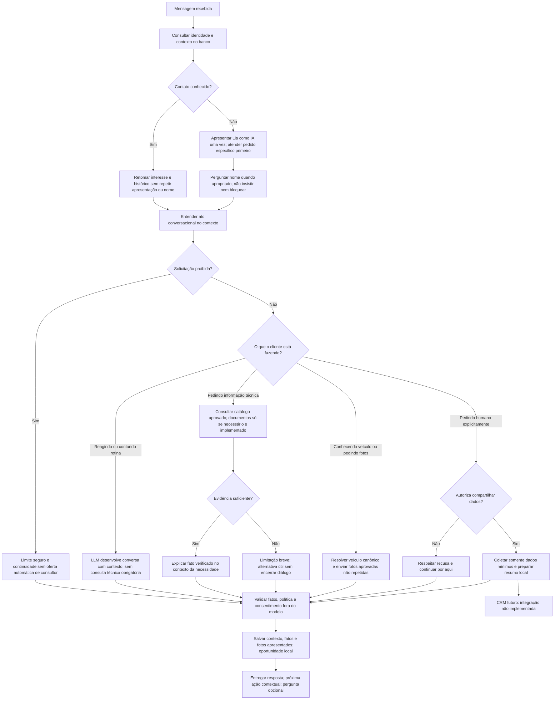

# Workflow da Lia — atendimento e operação

Mapa do baseline `1db98ff`. Para a implementação em avaliação, consulte [Lia v3](lia-v3.md).

Mapa do código em 2026-11-02. **Atual** descreve comportamento implementado;
**proposto** é desenho para revisão, sem implementação neste checkpoint.
O fluxograma pode ser visualizado no GitHub e no [desenho interativo](diagrams/lia-workflow.html).

## 1. Atendimento completo atual pelo WhatsApp

Detalhes: grupos, status, mensagens próprias e LID sem alias telefônico são ignorados.
Modo `*` foi autorizado e aceita qualquer remetente privado. Há 40 eventos por
pessoa/dia; ainda não há orçamento global de inferência. Exclusão é local, não
remove histórico da Evolution/WhatsApp. `sent` confirma aceite da API, não leitura.
Retry limitado ocorre para conexão não estabelecida e HTTP 429; erros ambíguos
ficam para revisão. Exceções anteriores ao envio também podem terminar em review.

## 2. Decisões dentro do LangGraph atual

`consult`, `guard`, `select`, `tools`, `compose` e `output` são nós do mesmo
grafo. As ramificações dentro dos nós acima são lógica Python, não novos agentes.
O piloto usa predominantemente seleção determinística. Até duas chamadas LLM
por turno; contexto compacto e fatos permitidos. O modelo atual é configurável.

## 3. Onde a experiência fica rígida

| Ponto comprovado no código | Consequência possível |
| --- | --- |
| `social_intent` reconhece um conjunto limitado de expressões | Uma paráfrase pode cair na consulta técnica por engano. |
| Resposta social usa allowlist de palavras | Uma formulação natural válida pode ser rejeitada e virar fallback. |
| Necessidade reconhecida usa LLM apenas para escolher um índice | Trocar o modelo não muda substancialmente a formulação disponível. |
| Mudança de prioridade sem fato pode acrescentar aviso de ausência de evidência | Compartilhar uma necessidade pode soar como pergunta técnica recusada. |
| Resposta à informação de recarga é um template | A conversa pode parecer encerrada após o cliente responder. |
| Grounding técnico possui três fatos revisados | Cobertura pequena de FAQ, especialmente B10 REEV. |
| `output` substitui referências não solicitadas a consultor | Segurança preservada, mas composição anterior pode ser perdida. |

O replay sintético do cenário viagem/economia foi executado sem inferência real.
Depois de “em casa”, a resposta atual apenas registra recarga e declara que os
detalhes técnicos precisam ser verificados. Isso evidencia o template, não mede
qualidade de um novo modelo nem comprova o comportamento em todas as conversas.

## 4. Fluxo consultivo proposto — ainda não implementado

Oportunidades comerciais locais já existem. A melhoria proposta é na escolha da
ação e composição, não na criação de outro grafo ou pipeline paralelo.

## 5. Outros canais e componentes

- **Chat web:** HTML/CSS/JavaScript → sessão privada → identidade de navegador
  → memória SQLite quando configurada → mesma implementação SalesAgent →
  barreira HTTP `/v1/` → texto e resolução de mídia aprovada.
- **API:** Bearer e token de sessão → SalesAgent → barreira HTTP. Não compartilha
  automaticamente identidade ou memória persistente com o WhatsApp.
- **Terminal:** CLI → SalesAgent → saída validada; contexto em memória da sessão,
  sem ligar automaticamente o banco de pessoas do piloto. Mostra IDs de mídia.
- **Dados atuais:** catálogo/fatos em JSON, fotos no disco e memória/oportunidades
  em SQLite. PostgreSQL/Redis em execução pertencem à Evolution. pgvector e RAG
  documental não participam deste fluxo de atendimento.
- **Operação:** systemd supervisiona backend; Docker supervisiona Evolution e suas
  dependências. Readiness do backend não prova que o WhatsApp está conectado.

## 6. Próximas mudanças e critérios de validação

1. Reproduzir paráfrases, respostas curtas e continuidade após recarga em testes.
2. Melhorar reconhecimento contextual e composição, preservando validação factual,
   política, consentimento e memória por contato.
3. Comparar transcrições sintéticas antes/depois; não depender apenas de snapshots.
4. Comparar provedores/modelos somente depois, com orçamento real autorizado.

Código rastreado: `app/channels/evolution_worker.py`, `evolution_store.py`,
`app/agent/service.py`, `consultative.py`, `social.py`, `grounding.py`,
`app/pilot_store.py`, `app/api/web_chat.py` e `commercial_boundary.py`.
Nenhum comportamento proposto foi ativado por esta documentação.
